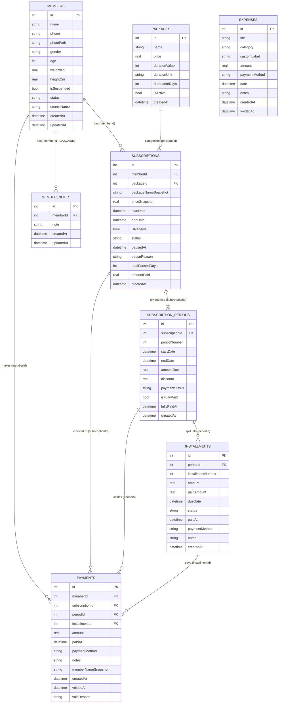

# Gym Management App — Database Specification & Architecture

Comprehensive database documentation for the gym management system, covering engine configuration, Entity-Relationship Model (ERD), full table definitions, constraints, indexes, relationships, migrations, and transactional workflows.

---

## 1. Database Architecture & Engine Configuration

- **ORM / Query Builder:** Drift (`drift: ^2.35.2`, `drift_flutter: ^0.3.1`)
- **Database Engine:** SQLite 3
- **Database File:** `gym_management_app.sqlite` (located in the application documents directory)
- **Current Schema Version:** `7`
- **Primary Database Class:** [`AppDatabase`](file:///home/sir/parttion2/Clients/gym_managment_app/lib/core/database/app_database.dart#L42)
- **Engine PRAGMAs & Hooks:**
  - Foreign Key Constraints: `PRAGMA foreign_keys = ON;` (enforced on every connection via `beforeOpen`).
  - Journal Mode: WAL (Write-Ahead Logging) via `drift_flutter`.
  - Manual WAL Flush: `PRAGMA wal_checkpoint(TRUNCATE);` executed prior to backups and file restores.
  - Legacy Cleanup: `DROP TABLE IF EXISTS attendance;` executed in `beforeOpen` and schema migrations.

---

## 2. Entity-Relationship Diagram (ERD)



---

## 3. Table Schemas & Column Details

### 3.1 `members`
- **Drift Class:** [`Members`](file:///home/sir/parttion2/Clients/gym_managment_app/lib/core/database/tables/members_table.dart#L6)
- **Table Name:** `members`
- **Purpose:** Stores core gym member profile records, health/body metrics, and membership status flags.
- **Indexes:**
  - `idx_members_name` on column `name`
  - `idx_members_phone` on column `phone`
  - `idx_members_status` on column `status`

| Column | Drift Type | SQLite Type | Nullable | Default | Constraints / References | Description |
|---|---|---|---|---|---|---|
| `id` | `IntColumn` | `INTEGER` | No | Auto-increment | `PRIMARY KEY` | Unique member ID |
| `name` | `TextColumn` | `TEXT` | No | None | `min: 1, max: 100` | Full name of the member |
| `phone` | `TextColumn` | `TEXT` | No | None | `min: 1, max: 20` | Phone / mobile number |
| `photoPath` | `TextColumn` | `TEXT` | Yes | `NULL` | None | Local filesystem path to avatar image |
| `gender` | `TextColumn` | `TEXT` | Yes | `NULL` | None | `'male'` or `'female'` |
| `age` | `IntColumn` | `INTEGER` | Yes | `NULL` | None | Age in years |
| `weightKg` | `RealColumn` | `REAL` | Yes | `NULL` | None | Body weight in kilograms |
| `heightCm` | `RealColumn` | `REAL` | Yes | `NULL` | None | Height in centimeters |
| `isSuspended` | `BoolColumn` | `INTEGER` | No | `false` | `0 / 1` | Indicates membership freeze / suspension |
| `status` | `TextColumn` | `TEXT` | No | `'active'` | None | Legacy / quick status: `'active'`, `'paused'`, `'expired'` |
| `searchName` | `TextColumn` | `TEXT` | Yes | `NULL` | None | Normalized Arabic text string for fast accent-agnostic searching |
| `createdAt` | `DateTimeColumn` | `INTEGER` | No | Current timestamp | None | Record creation date/time |
| `updatedAt` | `DateTimeColumn` | `INTEGER` | No | Current timestamp | None | Last modification date/time |

---

### 3.2 `packages`
- **Drift Class:** [`Packages`](file:///home/sir/parttion2/Clients/gym_managment_app/lib/core/database/tables/packages_table.dart#L3)
- **Table Name:** `packages`
- **Purpose:** Catalog of membership plans configured by gym management (durations, pricing, active states).

| Column | Drift Type | SQLite Type | Nullable | Default | Constraints / References | Description |
|---|---|---|---|---|---|---|
| `id` | `IntColumn` | `INTEGER` | No | Auto-increment | `PRIMARY KEY` | Unique package ID |
| `name` | `TextColumn` | `TEXT` | No | None | `min: 1, max: 100` | Package name (e.g., "اشتراك شهري") |
| `price` | `RealColumn` | `REAL` | No | None | None | Base price in currency units |
| `durationValue` | `IntColumn` | `INTEGER` | No | `30` | None | Numerical span value (e.g. 1, 3, 30) |
| `durationUnit` | `TextColumn` | `TEXT` | No | `'days'` | None | Unit of measure: `'days'` or `'months'` |
| `durationInDays` | `IntColumn` | `INTEGER` | No | None | None | Total equivalent calendar days (compatibility) |
| `isActive` | `BoolColumn` | `INTEGER` | No | `true` | `0 / 1` | Availability toggle for new registrations |
| `createdAt` | `DateTimeColumn` | `INTEGER` | No | Current timestamp | None | Package configuration date/time |

---

### 3.3 `subscriptions`
- **Drift Class:** [`Subscriptions`](file:///home/sir/parttion2/Clients/gym_managment_app/lib/core/database/tables/subscriptions_table.dart#L9)
- **Table Name:** `subscriptions`
- **Purpose:** Tracks contracts linking members to membership packages over calendar time ranges.
- **Indexes:**
  - `idx_subscriptions_end_date` on column `endDate`
  - `idx_subscriptions_start_date` on column `startDate`
  - `idx_subscriptions_status` on column `status`
  - `idx_subscriptions_member_id` on column `memberId`

| Column | Drift Type | SQLite Type | Nullable | Default | Constraints / References | Description |
|---|---|---|---|---|---|---|
| `id` | `IntColumn` | `INTEGER` | No | Auto-increment | `PRIMARY KEY` | Unique subscription ID |
| `memberId` | `IntColumn` | `INTEGER` | No | None | `REFERENCES members(id)` | Owner member reference |
| `packageId` | `IntColumn` | `INTEGER` | Yes | `NULL` | `REFERENCES packages(id)` | Associated package plan reference |
| `packageNameSnapshot` | `TextColumn` | `TEXT` | Yes | `NULL` | None | Preserved package name at subscription time |
| `priceSnapshot` | `RealColumn` | `REAL` | Yes | `NULL` | None | Preserved contract total price |
| `startDate` | `DateTimeColumn` | `INTEGER` | No | None | None | Effective subscription start date |
| `endDate` | `DateTimeColumn` | `INTEGER` | No | None | None | Effective subscription expiry date |
| `isRenewal` | `BoolColumn` | `INTEGER` | No | `false` | `0 / 1` | `true` if renewing an earlier subscription |
| `status` | `TextColumn` | `TEXT` | No | `'active'` | None | Current status: `'active'`, `'expired'`, `'paused'` |
| `pausedAt` | `DateTimeColumn` | `INTEGER` | Yes | `NULL` | None | Timestamp when subscription was paused |
| `pauseReason` | `TextColumn` | `TEXT` | Yes | `NULL` | None | Notes detailing the reason for pause |
| `totalPausedDays` | `IntColumn` | `INTEGER` | No | `0` | None | Accumulated paused days shifted to end date |
| `amountPaid` | `RealColumn` | `REAL` | No | `0.0` | None | Cached total sum of successful payments |
| `createdAt` | `DateTimeColumn` | `INTEGER` | No | Current timestamp | None | Record creation timestamp |

---

### 3.4 `subscription_periods`
- **Drift Class:** [`SubscriptionPeriods`](file:///home/sir/parttion2/Clients/gym_managment_app/lib/core/database/tables/subscription_periods_table.dart#L7)
- **Table Name:** `subscription_periods`
- **Purpose:** Represents individual billing/membership renewal segments inside a subscription agreement.
- **Indexes:**
  - `idx_subscription_periods_sub_id` on column `subscriptionId`
  - `idx_subscription_periods_dates` on columns `(startDate, endDate)`
  - `idx_subscription_periods_status` on column `paymentStatus`

| Column | Drift Type | SQLite Type | Nullable | Default | Constraints / References | Description |
|---|---|---|---|---|---|---|
| `id` | `IntColumn` | `INTEGER` | No | Auto-increment | `PRIMARY KEY` | Unique period segment ID |
| `subscriptionId` | `IntColumn` | `INTEGER` | No | None | `REFERENCES subscriptions(id)` | Parent subscription |
| `periodNumber` | `IntColumn` | `INTEGER` | No | `1` | None | Sequential period counter (1, 2, 3...) |
| `startDate` | `DateTimeColumn` | `INTEGER` | No | None | None | Start date for this period |
| `endDate` | `DateTimeColumn` | `INTEGER` | No | None | None | End date for this period |
| `amountDue` | `RealColumn` | `REAL` | No | None | None | Total required payment for period |
| `discount` | `RealColumn` | `REAL` | No | `0.0` | None | Concession/discount applied to amount due |
| `paymentStatus` | `TextColumn` | `TEXT` | No | `'unpaid'` | None | Settlement state: `'unpaid'`, `'partial'`, `'paid'` |
| `isFullyPaid` | `BoolColumn` | `INTEGER` | No | `false` | `0 / 1` | `true` if `totalPaid >= amountDue - discount` |
| `fullyPaidAt` | `DateTimeColumn` | `INTEGER` | Yes | `NULL` | None | Timestamp of the concluding payment |
| `createdAt` | `DateTimeColumn` | `INTEGER` | No | Current timestamp | None | Creation timestamp |

---

### 3.5 `installments`
- **Drift Class:** [`Installments`](file:///home/sir/parttion2/Clients/gym_managment_app/lib/core/database/tables/installments_table.dart#L7)
- **Table Name:** `installments`
- **Purpose:** Supports flexible installment plans for period payments.
- **Indexes:**
  - `idx_installments_period_id` on column `periodId`
  - `idx_installments_due_date` on column `dueDate`
  - `idx_installments_status` on column `status`

| Column | Drift Type | SQLite Type | Nullable | Default | Constraints / References | Description |
|---|---|---|---|---|---|---|
| `id` | `IntColumn` | `INTEGER` | No | Auto-increment | `PRIMARY KEY` | Unique installment ID |
| `periodId` | `IntColumn` | `INTEGER` | No | None | `REFERENCES subscription_periods(id)` | Parent period |
| `installmentNumber` | `IntColumn` | `INTEGER` | No | `1` | None | Sequence counter (1, 2, ...) |
| `amount` | `RealColumn` | `REAL` | No | None | None | Target sum for this installment |
| `paidAmount` | `RealColumn` | `REAL` | No | `0.0` | None | Current collected sum toward installment |
| `dueDate` | `DateTimeColumn` | `INTEGER` | No | None | None | Deadline date for this installment |
| `status` | `TextColumn` | `TEXT` | No | `'pending'` | None | State: `'pending'`, `'paid'` |
| `paidAt` | `DateTimeColumn` | `INTEGER` | Yes | `NULL` | None | Timestamp when completed |
| `paymentMethod` | `TextColumn` | `TEXT` | Yes | `NULL` | None | Method: `'cash'`, `'card'`, `'transfer'` |
| `notes` | `TextColumn` | `TEXT` | Yes | `NULL` | None | Installment notes |
| `createdAt` | `DateTimeColumn` | `INTEGER` | No | Current timestamp | None | Creation timestamp |

---

### 3.6 `payments`
- **Drift Class:** [`Payments`](file:///home/sir/parttion2/Clients/gym_managment_app/lib/core/database/tables/payments_table.dart#L11)
- **Table Name:** `payments`
- **Purpose:** Immutable ledger of collected revenues, membership fees, and installments with voiding support.
- **Indexes:**
  - `idx_payments_paid_at` on column `paidAt`
  - `idx_payments_member_id` on column `memberId`
  - `idx_payments_installment_id` on column `installmentId`
  - `idx_payments_voided_at` on column `voidedAt`

| Column | Drift Type | SQLite Type | Nullable | Default | Constraints / References | Description |
|---|---|---|---|---|---|---|
| `id` | `IntColumn` | `INTEGER` | No | Auto-increment | `PRIMARY KEY` | Unique payment transaction ID |
| `memberId` | `IntColumn` | `INTEGER` | No | None | `REFERENCES members(id)` | Payer member reference |
| `subscriptionId` | `IntColumn` | `INTEGER` | Yes | `NULL` | `REFERENCES subscriptions(id)` | Linked subscription |
| `periodId` | `IntColumn` | `INTEGER` | Yes | `NULL` | `REFERENCES subscription_periods(id)` | Linked subscription period |
| `installmentId` | `IntColumn` | `INTEGER` | Yes | `NULL` | `REFERENCES installments(id)` | Linked installment |
| `amount` | `RealColumn` | `REAL` | No | None | None | Monetary sum received |
| `paidAt` | `DateTimeColumn` | `INTEGER` | No | Current timestamp | None | Date and time payment was received |
| `paymentMethod` | `TextColumn` | `TEXT` | No | `'cash'` | None | Method: `'cash'`, `'transfer'`, `'wallet'` |
| `notes` | `TextColumn` | `TEXT` | Yes | `NULL` | None | Memo or receipt details |
| `memberNameSnapshot` | `TextColumn` | `TEXT` | Yes | `NULL` | None | Member name preserved at time of receipt |
| `createdAt` | `DateTimeColumn` | `INTEGER` | No | Current timestamp | None | Audit creation timestamp |
| `voidedAt` | `DateTimeColumn` | `INTEGER` | Yes | `NULL` | None | Soft-void cancellation timestamp |
| `voidReason` | `TextColumn` | `TEXT` | Yes | `NULL` | None | Justification for voiding payment |

---

### 3.7 `expenses`
- **Drift Class:** [`Expenses`](file:///home/sir/parttion2/Clients/gym_managment_app/lib/core/database/tables/expenses_table.dart#L6)
- **Table Name:** `expenses`
- **Purpose:** Ledger of gym operational expenditures (rent, utilities, equipment, repairs, staff costs).
- **Indexes:**
  - `idx_expenses_date` on column `date`
  - `idx_expenses_category` on column `category`
  - `idx_expenses_voided_at` on column `voidedAt`

| Column | Drift Type | SQLite Type | Nullable | Default | Constraints / References | Description |
|---|---|---|---|---|---|---|
| `id` | `IntColumn` | `INTEGER` | No | Auto-increment | `PRIMARY KEY` | Unique expense entry ID |
| `title` | `TextColumn` | `TEXT` | No | None | `min: 1, max: 150` | Description/title of the expenditure |
| `category` | `TextColumn` | `TEXT` | No | `'general'` | None | Category: `'rent'`, `'electricity'`, `'water'`, `'maintenance'`, `'other'` |
| `customLabel` | `TextColumn` | `TEXT` | Yes | `NULL` | None | Custom label when category is `'other'` |
| `amount` | `RealColumn` | `REAL` | No | None | None | Monetary sum disbursed |
| `paymentMethod` | `TextColumn` | `TEXT` | Yes | `NULL` | None | Method: `'cash'`, `'transfer'`, `'wallet'` |
| `date` | `DateTimeColumn` | `INTEGER` | No | Current timestamp | None | Date expense occurred |
| `notes` | `TextColumn` | `TEXT` | Yes | `NULL` | None | Additional expenditure notes |
| `createdAt` | `DateTimeColumn` | `INTEGER` | No | Current timestamp | None | Audit creation timestamp |
| `voidedAt` | `DateTimeColumn` | `INTEGER` | Yes | `NULL` | None | Soft-void cancellation timestamp |

---

### 3.8 `member_notes`
- **Drift Class:** [`MemberNotes`](file:///home/sir/parttion2/Clients/gym_managment_app/lib/core/database/tables/member_notes_table.dart#L5)
- **Table Name:** `member_notes`
- **Purpose:** Freeform historical notes and coaches' comments associated with a member.
- **Indexes:**
  - `idx_member_notes_member_id` on column `memberId`

| Column | Drift Type | SQLite Type | Nullable | Default | Constraints / References | Description |
|---|---|---|---|---|---|---|
| `id` | `IntColumn` | `INTEGER` | No | Auto-increment | `PRIMARY KEY` | Unique note ID |
| `memberId` | `IntColumn` | `INTEGER` | No | None | `REFERENCES members(id) ON DELETE CASCADE` | Parent member |
| `note` | `TextColumn` | `TEXT` | No | None | None | Note text content |
| `createdAt` | `DateTimeColumn` | `INTEGER` | No | Current timestamp | None | Timestamp of note creation |
| `updatedAt` | `DateTimeColumn` | `INTEGER` | No | Current timestamp | None | Timestamp of latest revision |

---

## 4. Foreign Key Relationships & Cascading Rules

| Parent Table | Parent Key | Child Table | Foreign Key Column | SQL Constraint | Deletion & Cascade Policy |
|---|---|---|---|---|---|
| `members` | `id` | `member_notes` | `memberId` | `ON DELETE CASCADE` | Database-level cascade deletes notes when member is deleted. |
| `members` | `id` | `subscriptions` | `memberId` | `NO ACTION` | Application-level transactional cascade in [`MembersDao.deleteMember`](file:///home/sir/parttion2/Clients/gym_managment_app/lib/core/database/daos/members_dao.dart#L165). |
| `members` | `id` | `payments` | `memberId` | `NO ACTION` | Deleted transactionally in [`MembersDao.deleteMember`](file:///home/sir/parttion2/Clients/gym_managment_app/lib/core/database/daos/members_dao.dart#L165). |
| `packages` | `id` | `subscriptions` | `packageId` | `NO ACTION` | Nullable; packages with existing subscriptions cannot be deleted ([`MembershipsDao.hasSubscriptions`](file:///home/sir/parttion2/Clients/gym_managment_app/lib/core/database/daos/memberships_dao.dart#L66)). |
| `subscriptions` | `id` | `subscription_periods` | `subscriptionId` | `NO ACTION` | Cleaned transactionally in [`MembershipsDao.deleteSubscription`](file:///home/sir/parttion2/Clients/gym_managment_app/lib/core/database/daos/memberships_dao.dart#L257). |
| `subscriptions` | `id` | `payments` | `subscriptionId` | `NO ACTION` | Nullable; cleaned transactionally on subscription deletion. |
| `subscription_periods` | `id` | `installments` | `periodId` | `NO ACTION` | Cleaned transactionally before subscription periods are removed. |
| `subscription_periods` | `id` | `payments` | `periodId` | `NO ACTION` | Nullable; cleaned transactionally on subscription deletion. |
| `installments` | `id` | `payments` | `installmentId` | `NO ACTION` | Nullable; cleaned transactionally on subscription deletion. |

---

## 5. Domain Enums & Column Allowed Values

### 5.1 Member Gender
- `'male'`
- `'female'`

### 5.2 Subscription Status (`subscriptions.status`)
- `'active'`: Currently valid and ongoing.
- `'paused'`: Temporarily frozen by owner.
- `'expired'`: Past expiry date or replaced by a new renewal.

### 5.3 Member Status Resolution (`MemberStatusType`)
Resolved dynamically in [`MembersDao.watchMembersWithStatus`](file:///home/sir/parttion2/Clients/gym_managment_app/lib/core/database/daos/members_dao.dart#L98):
1. If `isSuspended == true` $\rightarrow$ `MemberStatusType.paused`
2. Else if no active subscription or `endDate < today` $\rightarrow$ `MemberStatusType.expired`
3. Else if `endDate - today <= daysBeforeExpiry (default: 7)` $\rightarrow$ `MemberStatusType.expiringSoon`
4. Else $\rightarrow$ `MemberStatusType.active`

### 5.4 Payment & Installment Status
- `subscription_periods.paymentStatus`: `'unpaid'`, `'partial'`, `'paid'`
- `installments.status`: `'pending'`, `'paid'`

### 5.5 Payment Methods (`payments.paymentMethod`, `expenses.paymentMethod`)
- `'cash'`: Cash drawer
- `'transfer'`: Bank wire / InstaPay
- `'wallet'`: Mobile e-wallet (Vodafone Cash, etc.)
- `'card'`: Credit / debit card (installments)

### 5.6 Expense Categories (`expenses.category`)
- `'rent'`: Gym facility rent
- `'electricity'`: Electricity bills
- `'water'`: Water utility bills
- `'maintenance'`: Equipment servicing and repairs
- `'general'`: Operational defaults
- `'other'`: Custom category (reads `customLabel`)

---

## 6. Complete Index Catalog

| Table | Index Identifier | Target Columns | Rationale |
|---|---|---|---|
| `members` | `idx_members_name` | `name` | Fast alphabetical lookups |
| `members` | `idx_members_phone` | `phone` | Fast phone search and duplicate detection |
| `members` | `idx_members_status` | `status` | Direct status filtering |
| `subscriptions` | `idx_subscriptions_end_date` | `endDate` | Expiry calculation & expiring alerts |
| `subscriptions` | `idx_subscriptions_start_date` | `startDate` | Date range revenue & subscription queries |
| `subscriptions` | `idx_subscriptions_status` | `status` | Fast lookup of active vs paused/expired subscriptions |
| `subscriptions` | `idx_subscriptions_member_id` | `memberId` | Foreign key traversal to member subscriptions |
| `subscription_periods` | `idx_subscription_periods_sub_id` | `subscriptionId` | Child lookup for subscriptions |
| `subscription_periods` | `idx_subscription_periods_dates` | `(startDate, endDate)` | Multi-period scheduling validation |
| `subscription_periods` | `idx_subscription_periods_status` | `paymentStatus` | Filtering unpaid/partial debts |
| `installments` | `idx_installments_period_id` | `periodId` | Child lookup for periods |
| `installments` | `idx_installments_due_date` | `dueDate` | Overdue installment notifications |
| `installments` | `idx_installments_status` | `status` | Installment debt collection filtering |
| `payments` | `idx_payments_paid_at` | `paidAt` | Financial ledger ordering and daily/monthly reporting |
| `payments` | `idx_payments_member_id` | `memberId` | Member payment history and balance calculations |
| `payments` | `idx_payments_installment_id` | `installmentId` | Verification of installment clearance |
| `payments` | `idx_payments_voided_at` | `voidedAt` | Filtering out voided transactions in revenue sums |
| `expenses` | `idx_expenses_date` | `date` | Financial ledger timeline and date range sums |
| `expenses` | `idx_expenses_category` | `category` | Categorical expense reporting |
| `expenses` | `idx_expenses_voided_at` | `voidedAt` | Filtering out voided entries in expense sums |
| `member_notes` | `idx_member_notes_member_id` | `memberId` | Reverse lookup of member notes ordered by creation |

---

## 7. Migration Timeline (v1 to v7)

Implemented in [`AppDatabase.migration`](file:///home/sir/parttion2/Clients/gym_managment_app/lib/core/database/app_database.dart#L50):

- **v1 $\rightarrow$ v2:**
  - Added `age`, `weightKg`, `heightCm`, `isSuspended`, `searchName`, `updatedAt` to `members`.
  - Created `member_notes` table.
- **v2 $\rightarrow$ v3:**
  - Added `durationValue`, `durationUnit`, `isActive` to `packages`.
  - Added `packageNameSnapshot`, `priceSnapshot`, `pausedAt`, `pauseReason`, `totalPausedDays`, `amountPaid` to `subscriptions`.
- **v3 $\rightarrow$ v4:**
  - Created `subscription_periods` and `installments` tables.
  - Added `periodId` and `installmentId` to `payments`.
  - Migrated legacy subscription rows: generated synthesized period and installment records for each existing subscription and linked existing payment transactions.
- **v4 $\rightarrow$ v5:**
  - Dropped deprecated table: `DROP TABLE IF EXISTS attendance;`.
- **v5 $\rightarrow$ v6:**
  - Added `gender` to `members` table.
- **v6 $\rightarrow$ v7:**
  - Added `member_name_snapshot`, `created_at`, `voided_at`, `void_reason` to `payments`.
  - Added `custom_label`, `payment_method`, `created_at`, `voided_at` to `expenses`.

---

## 8. Data Access Objects (DAOs) & Key Queries

### 8.1 [`MembersDao`](file:///home/sir/parttion2/Clients/gym_managment_app/lib/core/database/daos/members_dao.dart#L38)
- **Tables:** `Members`, `Packages`, `Subscriptions`, `Payments`, `MemberNotes`
- **Key Methods:**
  - `watchMembersWithStatus(...)`: Reactive stream merging member details with their latest subscription, package, and calculated `MemberStatusType`. Supports Arabic normalized search across `searchName` and `phone`.
  - `deleteMember(int id)`: Executes a 6-step transactional cascade deleting payments, installments, subscription periods, subscriptions, notes, and the member.
  - `recordMemberPayment(...)`: Inserts payment and increments cached `subscriptions.amountPaid`.

### 8.2 [`MembershipsDao`](file:///home/sir/parttion2/Clients/gym_managment_app/lib/core/database/daos/memberships_dao.dart#L27)
- **Tables:** `Packages`, `Subscriptions`, `Members`, `Payments`
- **Key Methods:**
  - `atomicRenew(...)`: Expires lingering active subscriptions, creates the new subscription row, optionally records the payment transaction, and reactivates the member in a single transaction.
  - `atomicPause(...)`: Sets subscription and member to `'paused'` and records `pausedAt`.
  - `atomicResume(...)`: Calculates days frozen (`resumeDate - pausedAt`), extends `endDate` by the paused delta, adds to `totalPausedDays`, and reactivates subscription and member.
  - `deleteSubscription(int id)`: Transactionally cascades payments, installments, and periods, reactivating any prior valid subscription for the member.

### 8.3 [`FinanceDao`](file:///home/sir/parttion2/Clients/gym_managment_app/lib/core/database/daos/finance_dao.dart#L108)
- **Tables:** `Payments`, `Expenses`, `Members`, `Subscriptions`, `Packages`, `SubscriptionPeriods`
- **Key Methods:**
  - `watchLedger(...)` / `getLedgerEntries(...)`: Unifies `payments` (income) and `expenses` (outflow) into a unified descending chronological feed of `RawLedgerRow` items.
  - `getMonthlySummary(DateTime month)`: Aggregates non-voided payments and expenses to compute `revenue`, `expenses`, and `net`.
  - `getDailyTotals(...)`: Groups non-voided transactions by day for chart visualizations.
  - `getMembersWithBalance()`: Scans all member subscriptions vs non-voided payments to compile outstanding debtor accounts.

### 8.4 [`PaymentsDao`](file:///home/sir/parttion2/Clients/gym_managment_app/lib/core/database/daos/payments_dao.dart#L16)
- **Tables:** `Payments`, `Members`, `Subscriptions`, `SubscriptionPeriods`
- **Key Methods:**
  - `insertPayment(...)`: Adds new income receipt.
  - `voidPayment(int id, {String? reason})`: Soft-cancels payment by writing `voidedAt` and `voidReason`.
  - `sumBetween(DateTime from, DateTime to)`: Calculates total revenue excluding voided entries.

### 8.5 [`ExpensesDao`](file:///home/sir/parttion2/Clients/gym_managment_app/lib/core/database/daos/expenses_dao.dart#L10)
- **Tables:** `Expenses`
- **Key Methods:**
  - `insertExpense(...)` / `updateExpense(...)`: CRUD for gym costs.
  - `voidExpense(int id)`: Soft-cancels expense by writing `voidedAt`.
  - `sumBetween(DateTime from, DateTime to)`: Calculates total expenses excluding voided entries.

### 8.6 [`DashboardDao`](file:///home/sir/parttion2/Clients/gym_managment_app/lib/core/database/daos/dashboard_dao.dart#L36)
- **Tables:** `Members`, `Packages`, `Subscriptions`, `Payments`, `Expenses`
- **Key Methods:**
  - `countActiveMembers()`: Count of active members.
  - `countNewSubscriptions(...)`: Non-renewal subscription count in range.
  - `getExpiringSubscriptions(...)`: Subscriptions expiring within a forward window (e.g., 7 days).
  - `sumRevenue(...)` & `sumExpenses(...)`: High-level metrics for dashboard cards.

### 8.7 [`NotesDao`](file:///home/sir/parttion2/Clients/gym_managment_app/lib/core/database/daos/notes_dao.dart#L8)
- **Tables:** `MemberNotes`
- **Key Methods:**
  - `watchNotes(memberId)`: Reactive stream of notes ordered by `createdAt DESC`.
  - `insertNote`, `updateNote`, `deleteNote`.

---

## 9. Transactional Workflows & Business Rules

```
                      +-------------------+
                      |   atomicRenew()   |
                      +---------+---------+
                                |
      +-------------------------+-------------------------+
      |                         |                         |
      v                         v                         v
1. Expire Prior            2. Insert New            3. Create Payment
   Subscriptions              Subscription             (if supplied)
      |                         |                         |
      +-------------------------+-------------------------+
                                |
                                v
                   4. Reactivate Member Profile
                      (isSuspended = false, status = 'active')
```

```
                      +-------------------+
                      |   atomicPause()   |
                      +---------+---------+
                                |
        +-----------------------+-----------------------+
        |                                               |
        v                                               v
1. Mark Subscription                            2. Mark Member
   status = 'paused', pausedAt = now               isSuspended = true, status = 'paused'
```

```
                      +--------------------+
                      |   atomicResume()   |
                      +---------+----------+
                                |
1. Calculate shiftDays = (resumeDate - pausedAt) in days
                                |
        +-----------------------+-----------------------+
        |                                               |
        v                                               v
2. Update Subscription                          3. Update Member
   status = 'active'                               isSuspended = false
   endDate = endDate + shiftDays                   status = 'active'
   totalPausedDays += shiftDays
   pausedAt = null
```

---

## 10. Database Backup, Restore & Integrity Protection

Implemented in [`BackupSourceImpl`](file:///home/sir/parttion2/Clients/gym_managment_app/lib/features/settings/data/datasources/backup_source.dart#L87):

- **Backup Package Format (`.gymbak`):** ZIP container consisting of:
  - `database.sqlite`: SQLite database binary.
  - `manifest.json`: Metadata containing `app_version`, `schema_version`, `created_at`, `member_count`, and `checksum`.
  - `photos/`: Associated member avatar image files.
- **Integrity Validation:** SHA-256 hash computed on `database.sqlite` bytes and verified against `manifest.json` before restore.
- **Rollback Safety Buffer:** Prior to overwriting the database file during a restore, an automated safety snapshot (`_safety_backup_before_restore.gymbak`) is created. If schema migration or file replacement encounters errors, the database is rolled back automatically.
- **WAL Flush:** Executes `PRAGMA wal_checkpoint(TRUNCATE);` before backup creation and restore to ensure that write-ahead log contents are consolidated into the main `.sqlite` file.
